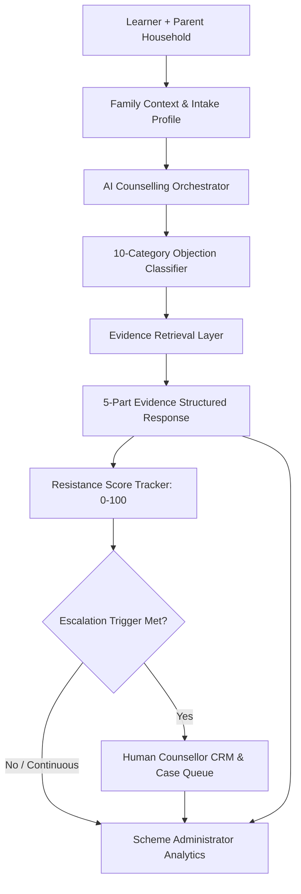

# VocaSaathi (व्होकासाथी)

> **"Helping families choose skills with confidence."**  
> *Most career-guidance platforms talk exclusively to the learner. **VocaSaathi talks to the family.***

---

## 1. Executive Summary & SIH Problem Statement
In India, vocational and skilling choices are fundamentally **family decisions**. Lower-income and semi-urban parents frequently hold deep hesitations regarding:
- **Starting income and lifetime earnings stagnation**
- **Social perception and degree stigma (BA/BSc/BCom vs. ITI)**
- **Higher education dead-ends (Can my child study further?)**
- **Workplace safety and local job availability**

Generic career bots fail because they provide abstract, generic advice ("Follow your passion") instead of **addressing parental risk-aversion with verified evidence**.

**VocaSaathi** bridges this gap with an evidence-first, bilingual (English + Marathi) AI counselling system that mediates family conversations, dynamically measures parental resistance reduction (e.g. 72 → 41), and automatically escalates unresolved cases to certified human counsellors.

---

## 2. System Architecture



---

## 3. Core Technical Features

### 🌟 Dual-Perspective Family Onboarding
Captures learner interests alongside parental risk concerns with a **1-Click "Load Demo Family (Pune)"** fast-track for instant evaluations.

### 📊 Evidence-First Retrieval Engine
Never hallucinates fake numbers. Every response is strictly anchored to 10 comprehensive vocational trades with NSQF Level 3-6 ladders, placement rates, starting salaries, and verified Maharashtra training providers.

### 🛡️ 10-Category Parental Objection Classifier
Systematically addresses doubts across *Income, Job Security, Social Status, Higher Education, Safety, Career Growth, Location, Course Quality, Family Expectations, and Placement*.

### 📉 Dynamic Resistance Meter (0–100)
Calculates real-time resistance shifts across four bands (Low, Moderate, High, Very High) with explainable before/after deltas (e.g., 72 → 41).

### 🔊 Low-Literacy & Marathi Accessibility
Full natural Marathi localization, high contrast UI, large touch targets, visual career ladders, and Web SpeechSynthesis (`🔊 Listen`) for rural households.

### 🔄 Multi-Trade Comparison Matrix
Compares up to 3 trades side-by-side across 10 empirical metrics + tailored "How this fits your learner" contextual insights.

### 📞 Automated Human Escalation & Counsellor CRM
Triggers automated case ticket generation with full conversation transcript, detected objections, and AI-recommended discussion points.

### 📈 Scheme Administrator Analytics Dashboard
Real-time calculated metrics: resistance reduction histograms, objection breakdown pie charts, regional district heatmaps (Pune, Nashik, Nagpur, Satara, Kolhapur, Chhatrapati Sambhajinagar), and AI policy insights.

---

## 4. Tech Stack
- **Framework:** Next.js 14 (App Router)
- **Language:** TypeScript 5.6
- **Styling & UI:** Tailwind CSS, Lucide Icons, Accessible Semantic HTML
- **Data Visualizations:** Recharts (BarCharts, PieCharts, Responsive Containers)
- **AI Abstraction:** Dual-mode provider architecture (`MockProvider` for 100% offline demo + `GeminiProvider` for Google Gemini 1.5 Flash)
- **Speech Synthesis:** Browser SpeechSynthesis API for Marathi/English audio readout

---

## 5. Quick Installation & Running Locally

```bash
# 1. Navigate to the project directory
cd vocasaathi

# 2. Install dependencies
npm install

# 3. Run automated test suite
npm test

# 4. Start local development server
npm run dev
```

Open [http://localhost:3000](http://localhost:3000) in your browser.

---

## 6. Zero-Key Demo Mode & Environment Variables
VocaSaathi works **100% out-of-the-box in DEMO MODE** without requiring any paid API keys or active internet access.

To enable live Google Gemini AI integration, create a `.env.local` file:

```env
GEMINI_API_KEY=your_google_gemini_api_key_here
```

---

## 7. 5-Minute SIH Demo Walkthrough
1. **Landing Page (`/`):** View core thesis: *"Choosing a career is a family decision."*
2. **Onboarding (`/counselling`):** Click **"⚡ Load Demo Family"** (Pune, 19 yrs, 12th Pass, Marathi).
3. **Counselling Room (`/counselling/session`):** 
   - Ask: *"ITI ke baad achhi job milegi kya? पगार किती मिळतो?"*
   - Observe the 5-part AI response and dynamic Evidence Card.
   - Click `🔊 Listen` for audio readout.
   - Ask: *"Degree karna better nahi hai?"* & *"पुढे शिकता येईल का?"*
   - Watch Resistance score drop from **72 → 41**.
4. **Compare Trades (`/compare`):** Side-by-side evaluation of Electrician vs. Solar PV vs. CNC Operator.
5. **Human Escalation:** Click **"Talk to a Counsellor"** to generate ticket `CASE-MH-2026-xxx`.
6. **Counsellor Portal (`/counsellor`):** Inspect case queue, transcript, and AI talking points.
7. **Admin Insights (`/admin`):** Review live district resistance heatmaps and calculated policy insights.

---

## 8. Ethical Data Disclaimer
> **Illustrative Hackathon Dataset:** All quantitative salary and placement figures are seeded illustrative benchmarks created for Smart India Hackathon demonstrations and do not represent official government census records.
