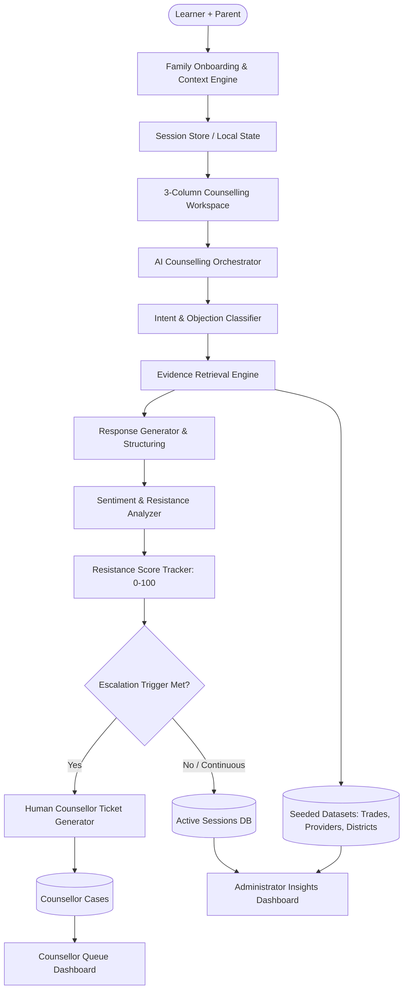

# VocaSaathi — System Architecture & Technical Design

## 1. System Overview Architecture

---

## 2. Layered Architecture

### A. Frontend Layer (Next.js 14 App Router + React 18 + Tailwind CSS)
- **Responsive 3-Column Layout:** 
  - Left: Dynamic Family Context & Resistance Gauge
  - Center: Multi-turn Chat Conversation with SpeechSynthesis audio playback and quick objection prompts
  - Right: Contextual Evidence Deck, Provider matches, and Pathway explorer
- **Accessibility & i18n:** Built-in dual language support (`en` and `mr`), high contrast, keyboard navigable, screen reader friendly.

### B. AI & Reasoning Layer (`/lib/ai` & `/lib/counselling`)
- **AI Abstraction Interface (`aiProvider.ts`):** Supports swapping between `MockProvider` (deterministic local intelligence) and `GeminiProvider` (Google Generative AI).
- **Evidence-First Constraint:** Real LLM prompts enforce strict anchoring to retrieved quantitative metrics (placement, salary, NSQF, duration). Zero fabrication.
- **Objection Taxonomy:** 10 core objection categories with sub-intent detection (Income, Job Security, Social Status, Higher Education, Safety, Career Growth, Location, Family Expectations, Course Quality, Placement).

### C. Evidence & Data Layer (`/data` & `/lib/data`)
- **Normalized Datasets:**
  - `trades.json`: 10 comprehensive vocational trades with NSQF pathways and local metrics
  - `providers.json`: 8 verified training providers across Maharashtra
  - `districts.json`: District-level analytics benchmarks
  - `sessions.json` & `cases.json`: Seeded operational sessions and counsellor escalations
- **Strict Labeling:** Every figure is tagged with `Illustrative Hackathon Dataset`.

### D. Escalation & Case Management Layer
- Automated threshold triggers (Resistance >= 75 after 3 turns, explicit human request, safety flags).
- Bundles full conversation context, extracted objections, resistance delta, and recommended counsellor talking points.

### E. Administrator Analytics Layer
- Real-time client-side calculation of:
  - Resistance reduction distribution
  - District hesitation heatmap
  - Objection category breakdown
  - Trade demand vs. hesitation matrix
  - Language engagement metrics
