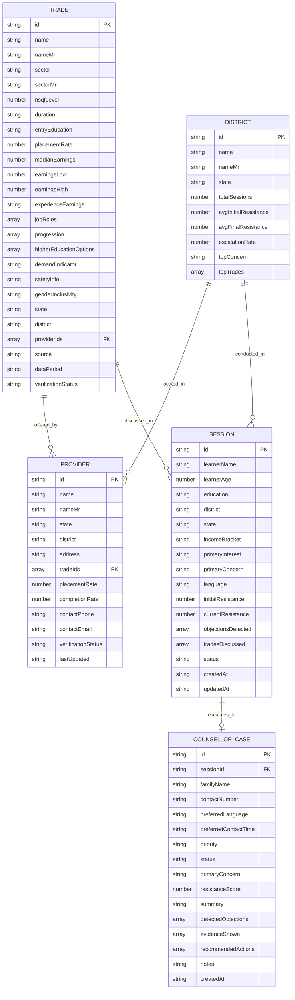

# VocaSaathi — Data Model Specification

## 1. Entity Relationships

---

## 2. Integrity Rules
1. Every `providerIds` entry in `trades.json` corresponds to a valid `id` in `providers.json`.
2. Every `district` in `trades.json`, `providers.json`, `sessions.json`, and `cases.json` corresponds to a valid district entry in `districts.json`.
3. All salary, placement, and completion numbers are internally consistent and labeled as `Illustrative Hackathon Dataset`.
